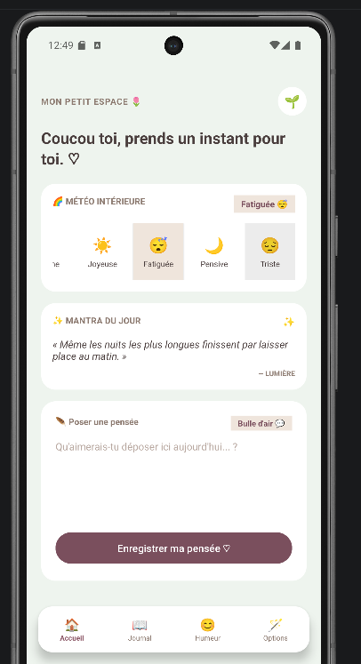
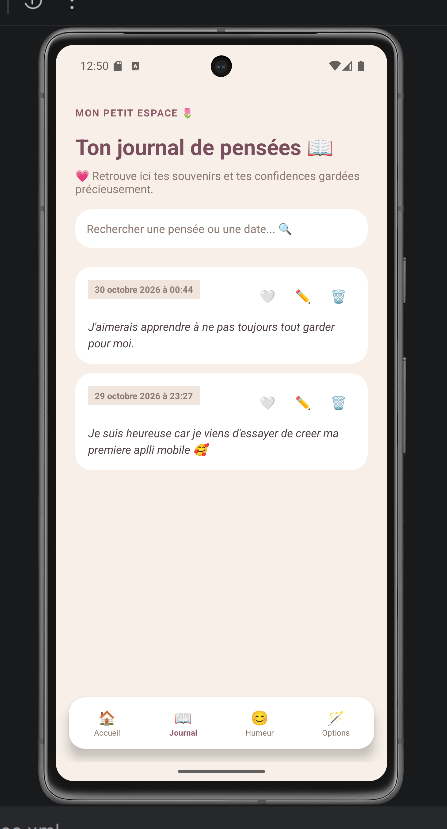
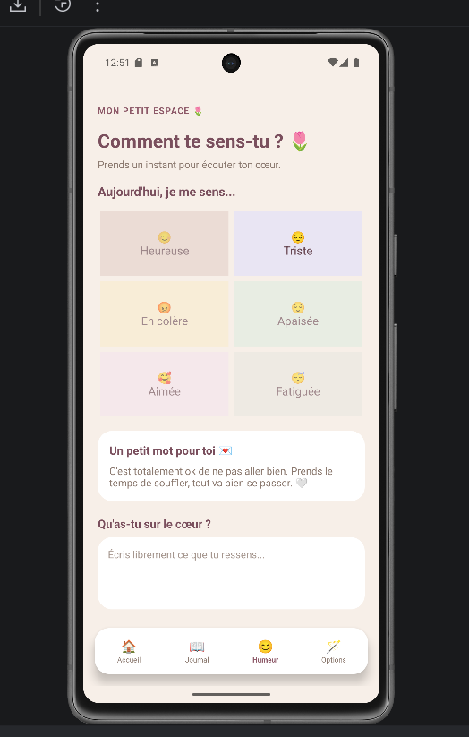
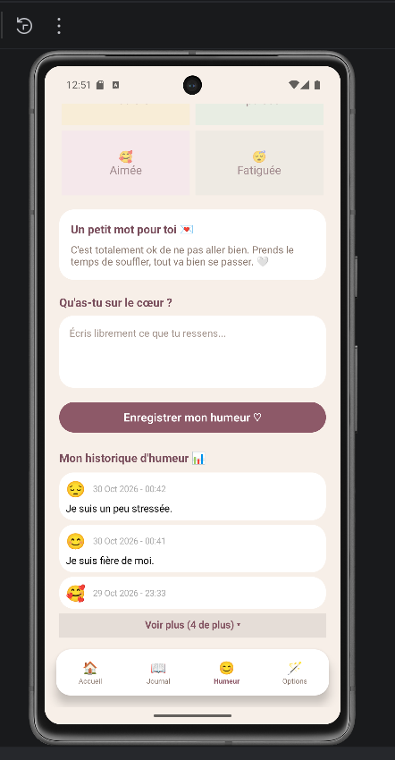
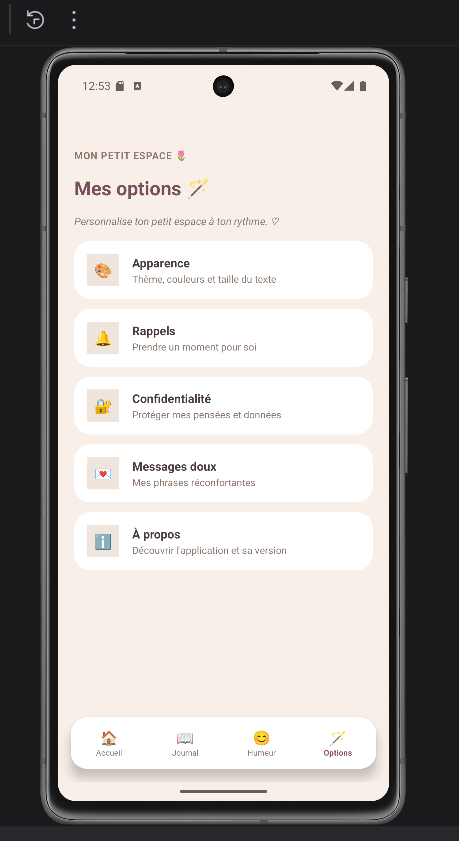
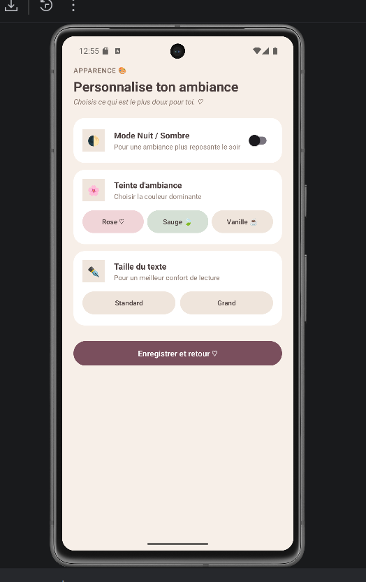
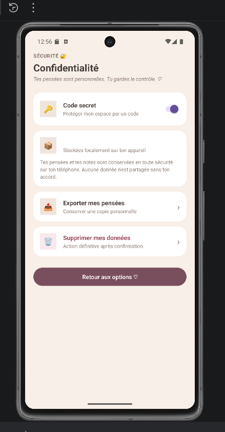
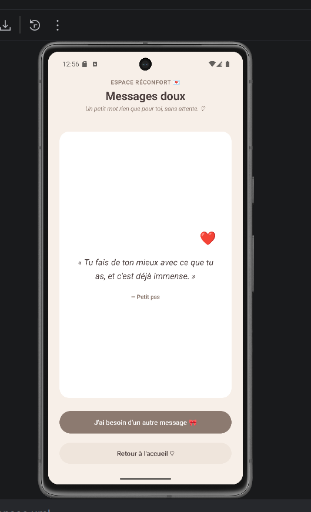
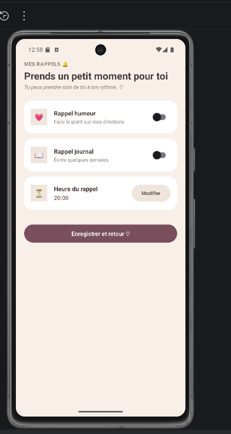
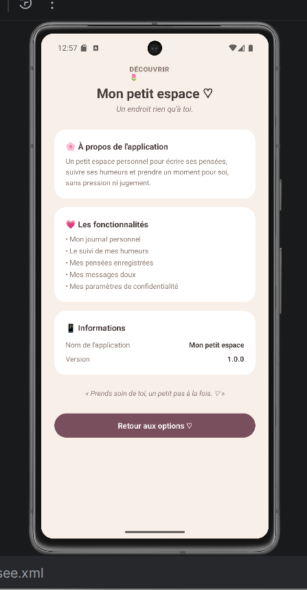

# 🌷 Mon petit espace

**Mon petit espace** est une application Android personnelle conçue comme un endroit où chacun peut déposer ses pensées librement, suivre son humeur et retrouver un espace à soi.

## 💭 À propos du projet

Ce projet a commencé en janvier 2026, en parallèle de mon apprentissage de la programmation mobile.

Au fil des cours, je découvrais de nouvelles notions et cherchais à les mettre en pratique dans ma propre application. Le projet a ainsi évolué progressivement, au rythme de ma formation et de mes apprentissages.

Il s'agit d'un projet personnel en cours de développement.

## ✨ Fonctionnalités

- **Accueil :** un espace pour déposer ses pensées.
- **Journal de pensées :** consulter, modifier et supprimer ses pensées.
- **Suivi de l'humeur :** enregistrer son humeur.
- **Options :** accéder aux préférences et aux paramètres de l'application.
- **Messages doux :** découvrir des messages réconfortants.
- **Verrouillage par code PIN :** protéger l'accès à son espace personnel.

## 📱 Aperçu de l'application

### 🏠 Accueil

### 📖 Journal de pensées

### 😊 Suivi de l'humeur

### 📊 Historique de l'humeur

### 🪄 Options

### 🎨 Apparence

### 🔒 Confidentialité

### 💌 Messages doux

### ⏰ Rappels

### ℹ️ À propos

## 🛠️ Technologies utilisées

- Java
- XML
- Android Studio
- SharedPreferences
- Git et GitHub

## 📚 Contexte d'apprentissage

Ce projet m'a permis de mettre en pratique les notions étudiées pendant ma formation en programmation mobile, de découvrir progressivement le développement Android et de développer mon autonomie.

## 🚀 Évolutions envisagées

- Amélioration de l'interface et de l'expérience utilisateur.
- Optimisation de la gestion des dates et des données locales.
- Exploration de SQLite et Room.
- Amélioration de la sécurité et des possibilités de stockage.
- Préparation d'une version plus aboutie de l'application.

---

**Statut :** Projet personnel en cours de développement.
